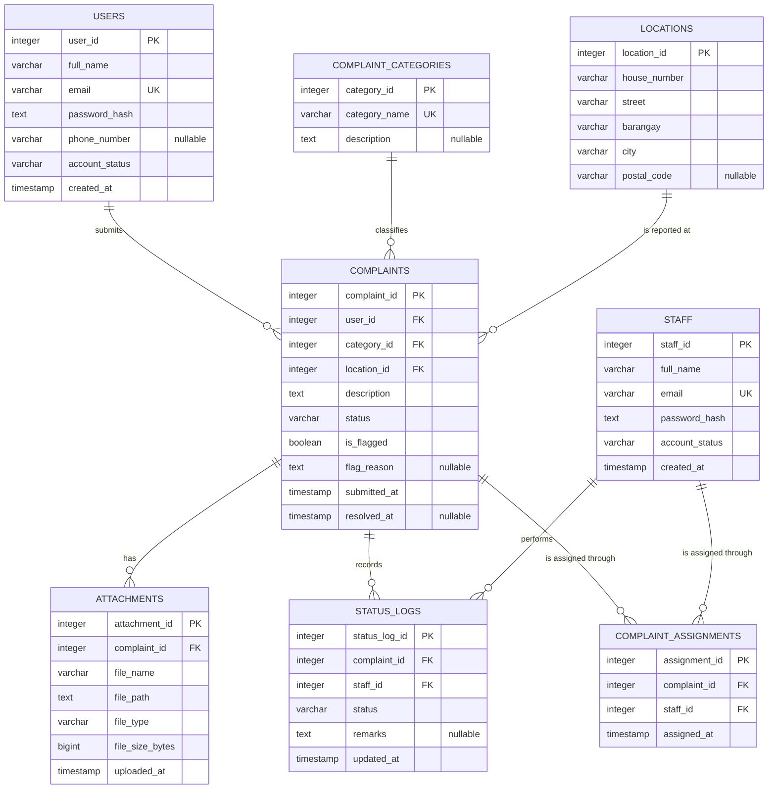

# Database documentation

Required by Activity 3, Part B. It describes what `database/01_schema.sql` builds. It follows Parts 5, 6, 7 and 9 of the approved Activity 2 blueprint, and any differences are listed at the end.

| Item | Value |
|---|---|
| Database | `dropboxed_db` |
| Schema | `dropboxed` |
| PostgreSQL version | 18.6 (17 or newer is required for the `MAINTAIN` privilege used by `dropboxed_dba`) |
| Database and object owner | `postgres` |
| Tables | 8 |
| Relationships | 7 (6 one-to-many, 1 many-to-many resolved by `complaint_assignments`) |
| Constraints | 8 primary keys, 8 foreign keys, 4 unique, 9 check, plus NOT NULL on required columns |
| Indexes | 22 (8 primary key, 4 unique, 10 added for joins and filters) |
| Sequences | 8, one identity sequence per table |
| Views, functions, triggers | None |

## Entity-relationship diagram

GitHub draws this diagram automatically. The group's original draw.io ERD is in Part 5 of the blueprint.

## Tables

Every primary key is `INTEGER GENERATED ALWAYS AS IDENTITY`. Column types and nullability match Part 7 of the blueprint exactly. Descriptions are also stored in the catalog with `COMMENT ON`, so `\d+` and pgAdmin show them.

| Table | Purpose | Business rules |
|---|---|---|
| `users` | Resident accounts | 1, 12 |
| `staff` | Water district staff and administrator accounts | 12 |
| `complaint_categories` | Water issue types | 3 |
| `locations` | Household addresses, each stored once and reused | 4 |
| `complaints` | Core complaint records | 1 to 5, 10, 11 |
| `complaint_assignments` | Which staff handle which complaints (M:N) | 6 |
| `status_logs` | Append-only history of status changes | 5, 7 |
| `attachments` | Photo metadata. The files are on disk in `uploads/`, at the relative path in `file_path`. | 8, 9 |

## Relationships

No foreign key has an `ON DELETE` action, so PostgreSQL refuses to delete a parent row that still has children. This protects the complaint history.

| Constraint | From | To | Cardinality |
|---|---|---|---|
| `fk_complaints_user` | `complaints.user_id` | `users.user_id` | One user, many complaints |
| `fk_complaints_category` | `complaints.category_id` | `complaint_categories.category_id` | One category, many complaints |
| `fk_complaints_location` | `complaints.location_id` | `locations.location_id` | One location, many complaints |
| `fk_attachments_complaint` | `attachments.complaint_id` | `complaints.complaint_id` | One complaint, many attachments |
| `fk_status_logs_complaint` | `status_logs.complaint_id` | `complaints.complaint_id` | One complaint, many logs |
| `fk_status_logs_staff` | `status_logs.staff_id` | `staff.staff_id` | One staff member, many logs |
| `fk_complaint_assignments_complaint` | `complaint_assignments.complaint_id` | `complaints.complaint_id` | M:N with `staff` |
| `fk_complaint_assignments_staff` | `complaint_assignments.staff_id` | `staff.staff_id` | M:N with `complaints` |

## Other constraints

| Constraint | Table | Rule |
|---|---|---|
| `uq_users_email`, `uq_staff_email` | `users`, `staff` | Unique email address |
| `uq_complaint_categories_name` | `complaint_categories` | Unique category name |
| `uq_complaint_assignments_complaint_staff` | `complaint_assignments` | A staff member is assigned to a complaint at most once |
| `ck_users_account_status`, `ck_staff_account_status` | `users`, `staff` | `Active` or `Inactive` |
| `ck_complaints_status`, `ck_status_logs_status` | `complaints`, `status_logs` | `Pending`, `In Progress` or `Resolved` |
| `ck_complaints_description` | `complaints` | Description is not blank |
| `ck_complaints_is_flagged` | `complaints` | TRUE or FALSE (blueprint Part 9) |
| `ck_complaints_resolved_at` | `complaints` | `resolved_at` is set if, and only if, the status is `Resolved` |
| `ck_attachments_file_type` | `attachments` | `image/jpeg` or `image/png` |
| `ck_attachments_file_size` | `attachments` | Greater than 0 |

**Defaults:** `status` is `Pending`, `is_flagged` is FALSE, `account_status` is `Active`, and `created_at`, `submitted_at`, `assigned_at`, `updated_at` and `uploaded_at` default to the current time.

## Indexes

PostgreSQL does not index foreign keys automatically, so each one has an index, either below or through a unique constraint.

| Index | Supports |
|---|---|
| `idx_complaints_user_id` | A resident's complaint list |
| `idx_complaints_category_id`, `idx_complaints_location_id` | Joins, filters, duplicate check |
| `idx_complaints_status` | Status filter, dashboard |
| `idx_complaints_submitted_at` | Date filters, sorting, reports |
| `idx_complaint_assignments_staff_id` | "Assigned to" filter, staff workload |
| `idx_status_logs_complaint_id` | A complaint's history, in time order |
| `idx_status_logs_staff_id` | Staff activity report |
| `idx_attachments_complaint_id` | A complaint's photos |
| `idx_locations_barangay` | Barangay reports and filter |

## Normalization

The design is in 3NF, as Part 8 of the blueprint explains. Photos, assignments and status history are separate tables rather than repeating columns. Every primary key is a single column, so partial dependencies cannot occur. Category, location and staff details are referenced rather than copied. `flag_reason` is only meaningful when `is_flagged` is TRUE, which the blueprint notes is a conditional relationship and not a functional dependency.

## Where database operations happen

| Operation | Code | Notes |
|---|---|---|
| Connection | `src/db/pool.js` | One `pg` pool. It sets `search_path` and `TimeZone` on each connection. |
| INSERT | `src/db/*.js` `create`, `insert`, `assign`, `findOrCreate` | |
| SELECT with joins, filters, sorting, pagination | `src/db/complaints.js` `search` | User values are parameters. Sort orders come from a fixed list. |
| Aggregates | `src/db/reports.js` | `COUNT ... FILTER`, `AVG`, `string_agg`, `GROUP BY`, `generate_series` |
| UPDATE | `setStatus`, `setFlag`, `updateProfile`, `updatePassword`, `setAccountStatus`, categories `update` | |
| DELETE | `assignments.unassign`, `categories.remove` | Complaints, accounts and history are never deleted. |
| Transactions | `src/services/complaints.js` `submit`, `advanceStatus` | `advanceStatus` locks the row with `SELECT ... FOR UPDATE`, so two staff cannot advance one complaint at once. |

## Differences from the approved blueprint

| Blueprint | Implementation | Reason |
|---|---|---|
| Part 11 says schema `dropbox`, Part 12 says `dropboxed` | `dropboxed` | The blueprint contradicts itself. Part 12 matches the project name. |
| Part 10 suggests JDBC or an ORM such as Hibernate for data access | `pg` (node-postgres) with hand-written parameterized SQL | The stack is Node.js/Express, which Part 10 also lists. Direct SQL keeps each query visible for DBA review. |
| Part 9 lists no check on the description | Added `ck_complaints_description` | Business Rule 2 needs a real description, and `NOT NULL` alone accepts a blank string. |
| `ck_complaints_resolved_at` "ensures a resolved complaint has a timestamp" | Also rejects a timestamp on an unresolved complaint | Prevents the opposite inconsistency. |
| No indexes specified | 10 indexes | Part 12 anticipated this under "Future Administration Concerns". |
| No roles specified | 4 group roles and 4 login roles | Activity 4 requires them. |

## Known limitations

From Part 12 of the blueprint, and still true: duplicate detection is in the application, photo storage is local disk, and `status_logs` and `attachments` will need an archiving strategy as they grow. Two more were found during implementation:

- `locations` has no unique constraint on the address. Two simultaneous submissions could store the same address twice. This has no effect on correctness except that the duplicate check would treat them as different households.
- `status_logs.staff_id` is required, so the original Pending state of a new complaint has no log row. Its `submitted_at` records that moment instead.
